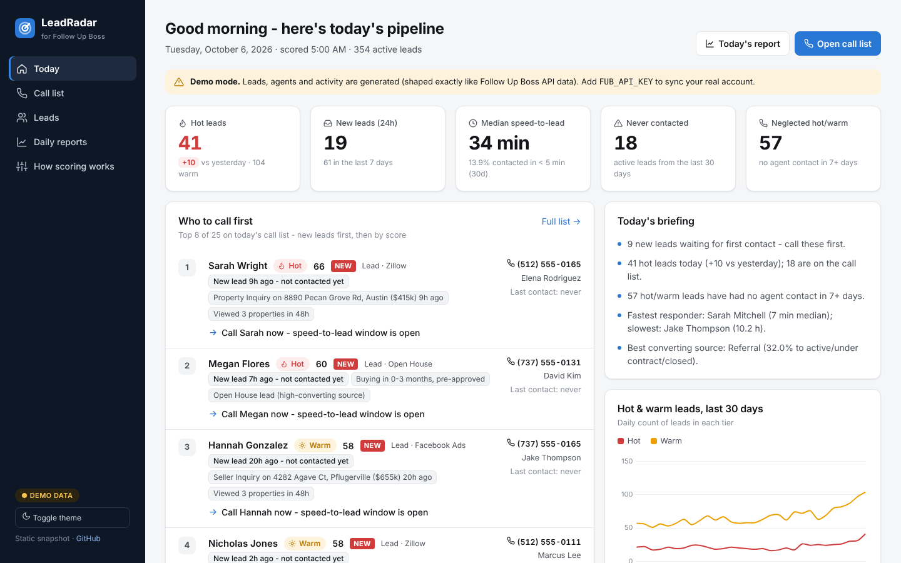
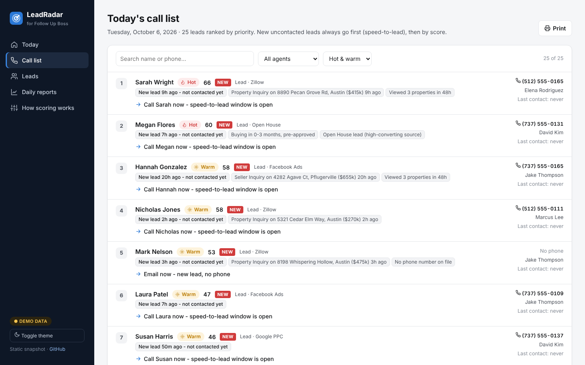
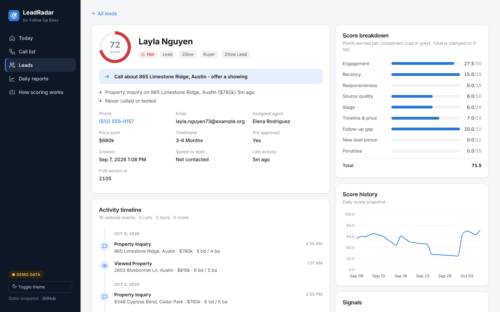
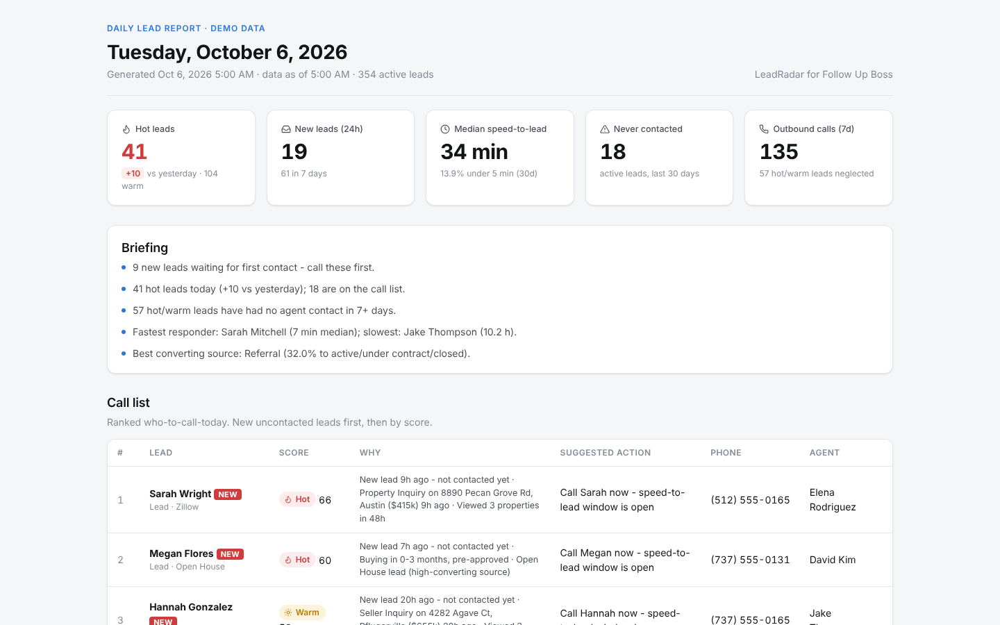
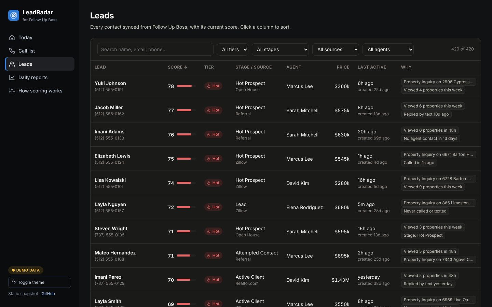

# LeadRadar: lead scoring for Follow Up Boss (demo)

**Live demo:** <https://followupboss-psi.vercel.app/>

LeadRadar syncs a [Follow Up Boss](https://www.followupboss.com/) CRM account (leads, calls, texts, notes, tasks, deals) and scores every lead **Hot / Warm / Cold** with plain-English reasons. It then builds a ranked **"who to call today"** list and a daily analysis report with charts.

This repository is the **static demo**: the full dashboard exported to plain HTML, running on ~420 realistic *generated* leads. It includes 90 days of activity, a lead page for every lead and 15 archived daily reports. Every name, email and phone number is fake (`@example.com`, `555` numbers). The Python app behind it (FUB sync, scoring engine, report generator) is kept private.

| Call list | Lead detail |
|---|---|
|  |  |

| Daily report | Leads (dark mode) |
|---|---|
|  |  |

## What's in the demo

- **Today:** KPIs, briefing, top leads to call.
- **Call list:** ranked who-to-call-today. Brand-new uncontacted leads come first (speed-to-lead), then Hot and Warm by score, each with a suggested action.
- **Leads:** searchable, sortable table. Each lead page has a score breakdown, score history and full activity timeline.
- **Reports:** archived daily HTML reports with lead volume by source, pipeline by stage, conversion, speed-to-lead histogram, agent scorecard and neglected leads.
- **How scoring works:** the transparent 0–100 model.

## How scoring works

| Component | Max | Signal |
|---|---:|---|
| Engagement | 30 | Property views, saves, searches, inquiries in the last 7 days (last 48h counts 1.5×) |
| Recency | 15 | Time since the lead's own last activity (exponential decay) |
| Responsiveness | 15 | Inbound texts/calls and "Interested" call outcomes |
| Source quality | 10 | Referral / open house > portals > paid social |
| Stage | 10 | Hot Prospect / Active Client highest |
| Timeline & price | 10 | Buying timeframe, pre-approval, price point |
| Follow-up gap | 10 | Engaged lead the team hasn't contacted lately, or ever |
| New-lead bonus | 12 | Uncontacted lead under 72h old |
| Penalties | | −20 "Not Interested", −15 bad number |

**Hot ≥ 60, Warm ≥ 40, Cold below.**

## View it

- **GitHub Pages:** go to **Settings → Pages → Deploy from a branch → `main` / `(root)`**.
- **Locally:** open `index.html`, or run `python -m http.server` and visit <http://localhost:8000>.

## Tech

Production app: Python · FastAPI · SQLAlchemy/SQLite · Jinja2 · Chart.js · Follow Up Boss REST API (paginated incremental sync with retry/backoff)
